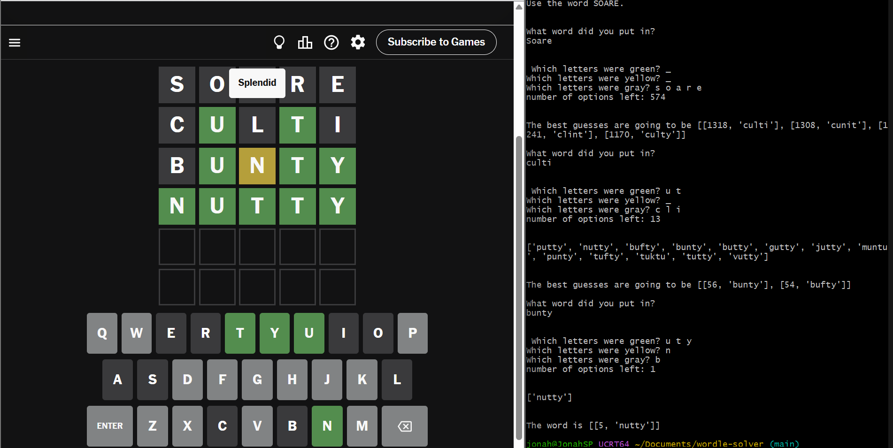

# Wordle Solver

A command-line helper for solving Wordle puzzles, written in Python. Enter each guess and the colors Wordle gave you, and the program narrows down the word list and suggests strong next guesses based on letter statistics.

This project was made in 2022 without the use of any AI or code generation tools. 

<p align="center">
  
</p>

## Features

- **Filters a full word list** after every guess using your green, yellow, and gray feedback
- **Suggests a strong opening word** (SOARE) when the full list is loaded
- **Tracks how many possible words remain** after each guess
- **Shows the remaining candidates** once 50 or fewer are left
- **Recommends next guesses** by analyzing letter frequency overall and by position
- **Stops automatically** when only one possible word is left

## Getting Started

### Requirements

- Python 3.6+
- No external libraries (uses only Python's built-in `re` module)

### Installation

```bash
git clone https://github.com/YOUR-USERNAME/wordle-solver.git
cd wordle-solver
```

### Word list

The program reads its words from a file named `Words.txt` in the `docs` folder. The file should contain one lowercase five-letter word per line. The opening-word tip appears when the full list of 12,946 words is loaded.

## How to Use

After each guess you make in Wordle, the program asks four questions:

| Prompt | What to enter |
| --- | --- |
| What word did you put in? | The five-letter word you guessed |
| Which letters were green? | Letters in the correct spot, separated by spaces |
| Which letters were yellow? | Letters in the word but in the wrong spot, separated by spaces |
| Which letters were gray? | Letters not in the word, separated by spaces |

Type `_` for any category that had no letters.

### Example

```
What word did you put in?
soare
 Which letters were green? _
Which letters were yellow? a
Which letters were gray? s o r e
```

The program then prints how many possible words are left, plus suggested next guesses. Repeat with your next guess until the answer is found.

## How It Works

- **Letter statistics:** the program counts how often each letter appears across the word list, both overall and in each of the five positions.
- **Guess scoring:** it builds candidate words from the most common letters, scoring them in two ways: by position-specific frequency and by overall letter frequency (skipping words with repeated letters). Words that rank well on both are shown as the best guesses.
- **Filtering:** green letters keep only words with that letter in that position. Yellow letters keep only words that contain the letter somewhere else. Gray letters remove any word containing the letter.
- **Narrowing down:** after each round, the statistics are recalculated on the remaining words, so the suggestions improve as the list shrinks.

## Project Structure
```
wordle-solver/
├── docs/
│   ├── screenshot.png
│   └── Words.txt
├── src/
│   └── Wordle.py
├── LICENSE
└── README.md
```
## License

This project is licensed under the MIT License. See the `LICENSE` file for details.
